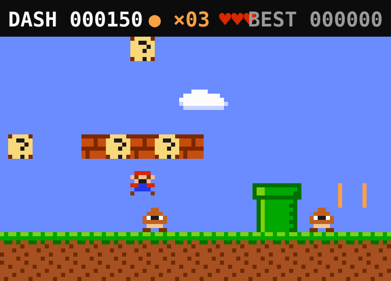

<div align="center">

# Pixel Dash

**A tiny pixel-art platformer in a Claude Code side pane.** Something to play while Claude works.

A [Claude Code mod](https://claude.dev/blog/getting-started-with-claude-code-mods/) for the desktop Code tab and the terminal.

[](LICENSE)
[](https://claude.dev/blog/getting-started-with-claude-code-mods/)
[](https://github.com/Talap-creator/pixel-dash/releases)



</div>

## Install

```
/plugin marketplace add Talap-creator/pixel-dash
/plugin install pixel-dash@pixel-dash
/reload-plugins
```

## Play

1. Type `/play` — the game opens in a side pane.
2. **Click the red strip under the picture** (in the terminal, click the game) so it gets the keys.
3. Run to the flag.

| key | |
|---|---|
| `→` `←` / `D` `A` | run (hold it) |
| `↑` / `space` / `W` | jump |
| `R` | start over |
| `Esc` | give the keys back to the prompt |

## The course

One hand-built level, **World 1-1**, about 110 tiles long:

- coins (+50, 100 of them give a life) and `?` blocks you hit from below (+200)
- ten goombas — land on top to squash one (+100), touch one from the side and you lose a life
- two pits, four pipes, platforms on two heights, a staircase and the flag (+1000, plus 500 per life left)
- three lives and a checkpoint halfway; your best score is kept between sessions

## How it draws

- **Desktop Code tab:** every frame is an SVG — square, crisp pixels that scale to the pane's width.
- **Terminal:** every character cell is two square pixels stacked (`▀`, top pixel as its colour, bottom as its background).

Every tile and sprite is a 6×6 piece of pixel art in a NES-style palette. The game runs at 20 frames a second in the pane's own surface module, so it costs no tokens and never touches your session.

Terminals report key presses but not releases, so running rides on your keyboard's key repeat and you coast for a moment after letting go.

## Develop

```
claude plugin validate plugins/pixel-dash
claude plugin test plugins/pixel-dash
```

Hack on it live with `claude --plugin-dir plugins/pixel-dash`. The game is in [`plugins/pixel-dash/hooks/game.tsx`](plugins/pixel-dash/hooks/game.tsx): level, physics, sprites and drawing in one file.

## License

[MIT](LICENSE). Pixel Dash is an homage to classic side-scrollers, with its own sprites; it is not affiliated with any game company.
